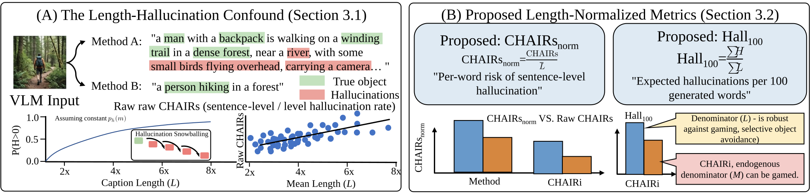

# Length-Controlled Hallucination Evaluation

This repository contains code for length-normalized re-evaluation of hallucination benchmarks, including CHAIR metric normalization, matched-length truncation analysis, and cross-model correlation analysis.

## Abstract

Evaluating whether vision-language models (VLMs) hallucinate is a foundational task for AI alignment: safety certifications, governance decisions, and claims of progress in hallucination mitigation all depend on the reliability of benchmark metrics. Yet the de facto standard metric for object hallucination—CHAIR<sub>s</sub>—contains a systematic but unexamined length confound. Because longer captions necessarily provide more opportunities for hallucination, a method that produces shorter outputs (or a model trained to be terse) will achieve a lower CHAIR<sub>s</sub> score regardless of whether it genuinely reduces per-token hallucination propensity. We formalize this confound through a probabilistic model showing that the probability of at least one hallucination grows mechanically with caption length even under identical per-token risk, and we conduct a systematic empirical re-evaluation across five VLM architectures and ten decoding methods spanning 50 model–method combinations. We propose two interpretable, computationally free length-normalized metrics: **CHAIRs<sub>norm</sub>** (per-100-word risk of introducing at least one hallucination) and **Hall<sub>100</sub>** (expected hallucinated objects per 100 generated words), the latter normalizing by the exogenous caption length rather than the endogenous mentioned-object count, which cannot be gamed by selective mention. Our core empirical result is a significant and policy-relevant ranking disruption: the method achieving the best raw CHAIR<sub>s</sub> score (OPERA, 50.5%) is not the best after normalization—VCD attains the lowest CHAIRs<sub>norm</sub> (49.9) and Hall<sub>100</sub> (14.6 per 100 words) while generating the longest captions, consistent with genuine per-token hallucination suppression. We further demonstrate that community-standard sample sizes (*N* = 100–500) are statistically underpowered, with bootstrap 95% confidence intervals spanning ±7–±12 percentage points—far wider than the typical pairwise gaps they are meant to adjudicate. We conclude with five actionable recommendations: mandatory length-normalized reporting, bootstrap confidence intervals as standard practice, transparent reporting of caption length statistics, constrained-format benchmarks as length-free controls, and increased sample sizes (*N* ≥ 1,000). Addressing this confound requires no new models, data, or infrastructure—only the methodological discipline to normalize what we already measure. Our code and data are provided in the supplementary material.

## Method Overview



## File Structure

```
.
├── README.md
├── setup_coco.md                   # COCO annotations setup guide
├── config.py                       # Path configuration (models, datasets, outputs)
├── cross_model_analysis.py         # Normalized CHAIRs/Hall_100 + LaTeX tables
├── matched_length_truncation.py    # Matched-length truncation analysis
├── per_caption_chair_eval.py       # Per-caption CHAIR evaluation
├── length_control_analysis.py      # Length-controlled CHAIR analysis
├── delta_chair_correlation.py      # Delta_t decline vs CHAIRs correlation
├── extract_all_metrics.py          # Aggregate baseline results → baseline_summary.json
├── generate_all_experiments.py     # Generate experiment tables and figures
├── generate_paper_figures.py       # Alternative figure generator
├── asset/
│   └── myway.svg                   # Method overview figure
└── common_utils/
    └── chair_eval.py               # Standard CHAIR metric implementation
```

## Environment Setup

```bash
pip install numpy nltk matplotlib tqdm --break-system-packages
python3 -c "import nltk; nltk.download('punkt'); nltk.download('averaged_perceptron_tagger'); nltk.download('wordnet')"
```

Set the `DATA_HOME_ROOT` environment variable or edit `config.py` to point to
your data directory (model weights, COCO images, annotations).

## Data Flow Overview

All analysis scripts depend on upstream data produced by running model
inference over benchmark datasets. The end-to-end pipeline is:

```
Model Inference        →  CHAIR/Hallusion/MMHal/POPE result files
                            ↓
extract_all_metrics.py →  results/baseline_summary.json
                            ↓
generate_all_experiments.py →  figures + LaTeX tables
generate_paper_figures.py  →  alternative figures
cross_model_analysis.py    →  normalized CHAIR tables
```

The per-caption CHAIR pipeline runs in parallel:

```
Caption JSONL files     →  per_caption_chair_eval.py  →  per_caption_chair.csv
                                                           ↓
                            matched_length_truncation.py  →  LaTeX table
                            length_control_analysis.py    →  plots + metrics
```

## Script Reference

### `common_utils/chair_eval.py`

Standard CHAIR metric evaluation for a single caption file.

```bash
python3 common_utils/chair_eval.py \
    --cap_file outputs/my_captions.jsonl \
    --coco_path path/to/coco/annotations/ \
    --save_path results/chair_eval_output.json
```

**Input**: A JSONL file with `{"image_id": ..., "caption": "..."}` per line  
**Output**: Per-caption + aggregate CHAIRs, CHAIRi, Recall, Len metrics  
**Requires**: COCO 2014 annotations (see `setup_coco.md`)

### `per_caption_chair_eval.py`

Batch CHAIR evaluation over multiple model×method caption files.
Produces the per-caption CSV needed by the truncation analysis.

```bash
python3 per_caption_chair_eval.py \
    --caption_dir captions/ \
    --coco_dir coco_annotations/annotations/ \
    --output per_caption_chair.csv \
    --split val
```

**Input**: Directory of `{model}_{method}.jsonl` files  
**Output**: `per_caption_chair.csv` (per-caption H_i, M_i, L_i)  
**Requires**: COCO 2014 annotations, caption files from model inference

### `matched_length_truncation.py`

Non-parametric length normalization by simulating equal-length conditions.

```bash
python3 matched_length_truncation.py per_caption_chair.csv
```

**Input**: `per_caption_chair.csv` (from `per_caption_chair_eval.py`)  
**Output**: Console summary + `tables/matched_length_cross.tex`

### `length_control_analysis.py`

Full length-controlled CHAIR analysis pipeline with visualization.

```bash
python3 length_control_analysis.py --model llava
python3 length_control_analysis.py --model all
```

**Input**: CHAIR output JSONL files in `chair_out/`  
**Output**: `results/length_control/{model}/length_control_results.json` + plots  
**Requires**: Pre-computed CHAIR captions in `chair_out/*.jsonl`

### `extract_all_metrics.py`

Scans `results/baseline/` and aggregates metrics from all benchmark result
files into a structured JSON summary.

```bash
python3 extract_all_metrics.py
```

**Expected input files** (placed under `results/baseline/`):
- `hallusion_{model}_{method}_result.json` — HallusionBench per-model results
- `hallusion_{model}_{method}_eval_v{s,d}.json` — HallusionBench eval files
- `mmhal_{model}_{method}_result.json` — MMHal-Bench results
- `chair_{model}_{method}.jsonl` — CHAIR caption outputs
- `pope_{subset}_{model}_{method}.json` — POPE responses

**Output**: `results/baseline_summary.json`

### `generate_all_experiments.py`

Generates experiment tables and figures from the aggregated summary.

```bash
python3 generate_all_experiments.py
```

**Input**: `results/baseline_summary.json` (from `extract_all_metrics.py`)  
  Also reads, when available:
  - `results/diagnostic/diagnostic_raw_llava.json` — trajectory data
  - `results/diagnostic_validation/signal_baseline_comparison.json` — AUROC
  - `results/diagnostic_validation/diagnostic_signal_validation.json` — sentence-level AUROC
  - `results/diagnostic_validation/diagnostic_signal_validation_data.npz` — calibration data

**Output**: LaTeX tables + PDF figures under `output/`

### `generate_paper_figures.py`

Alternative figure generation from `results/baseline/` data.

```bash
python3 generate_paper_figures.py
```

**Input**: Result files in `results/baseline/`  
**Output**: PDF figures under `output/figures/`

### `cross_model_analysis.py`

Cross-model normalized CHAIR analysis: computes CHAIRs_norm, Hall_100,
per-model length-CHAIRs correlations, and rank-disruption statistics.

```bash
python3 cross_model_analysis.py
```

**Input**: `tables/chair_eval_all.csv`  
  CSV columns: model, method, CHAIRs, CHAIRi, Recall, Len  
  Generate this CSV by aggregating per-model CHAIR evaluation outputs.

**Output**:
- `tables/cross_model_norm.tex` — Best raw vs normalized CHAIRs per model
- `tables/per_model_corr.tex` — Per-model length-CHAIRs regression
- `tables/pooled_ols.tex` — Pooled cross-model OLS analysis

### `delta_chair_correlation.py`

Correlation analysis between Delta_t grounding decline and CHAIRs.

```bash
python3 delta_chair_correlation.py
```

**Input**:
- `results/diagnostic/diagnostic_methods_*.json` — Per-method trajectory data
- `tables/chair_eval_all.csv` — Aggregate CHAIR data

## Normalized Metrics

- **CHAIRs_norm** = CHAIRs / mean_caption_length × 100  
  Per-100-word risk of introducing at least one hallucination.

- **Hall_100** = Σ H_i / Σ L_i × 100  
  Expected hallucinated objects per 100 generated words.

## Notes

- **Bootstrap CI**: Bootstrap 95% confidence intervals for CHAIR metrics rely
  on per-caption data. Generate `per_caption_chair.csv` via
  `per_caption_chair_eval.py` to enable this computation.
- **Token vs Word normalization**: The scripts use word-level splitting.
  Token-level comparison requires per-model HuggingFace tokenizer
  integration (not included).
- **Data location**: Set `DATA_HOME_ROOT` or edit `config.py` to point to
  your local data directory (model weights, COCO images, annotations).
